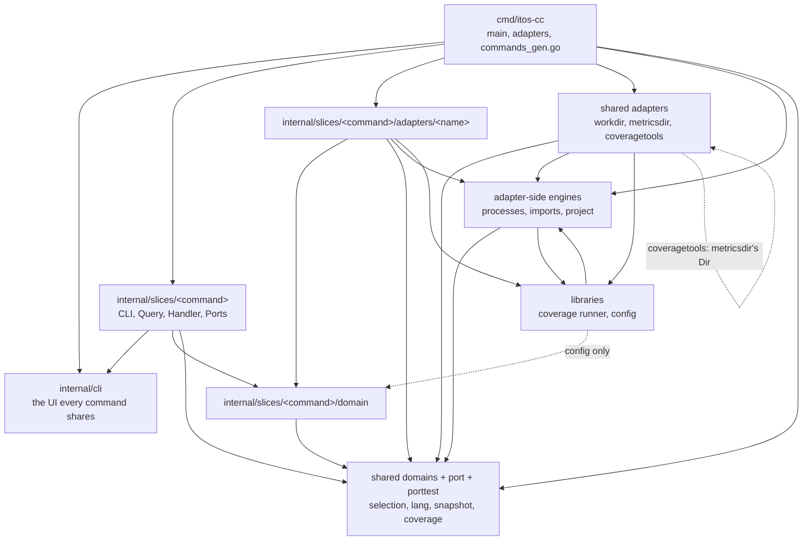

# Architecture

Where the code stands after every refactor, and the rules that keep it there. `docs/go.md` is
the rulebook, package by package; `docs/CLI.md` is the product contract this code serves. A Go
command-line project can take the layout below whole.

## The idea

Entry points stay thin over behaviour the domain owns, reached through ports. Each command is a
vertical slice under `internal/slices/<command>` that owns its command line, its application
code and, when it needs one, its own domain and adapters; what several commands share lives in
engines the slices import, never in another slice (ADR-0051, which superseded decision 29's
layout and kept its arrows). Dependencies point inward: an adapter or a port may use the domain's
own types, so no mapper translates between them, and nothing from outside is imported into a
domain (ADR-0047). A domain knows no UI, filesystem implementation, encoding or exit code; it may
carry `json` and `yaml` struct tags used only for serialization (decision 50).

## The layout

An arrow is an import the rules allow. Every arrow not drawn is refused.

| Layer | Paths | May import | Held by |
| --- | --- | --- | --- |
| Assembly | `cmd/itos-cc` | everything; the one place that knows every package, and with `internal/cli` the only importer of kong | `kong`; `architecture-check --outside` and `--toplevel` let it in |
| UI | `internal/cli` | nothing of ours | `ui` |
| Slice | `internal/slices/<x>` | the shared domains and ports, `internal/cli`, its own subpackages | `slice-packages`, `slice-adapters`, `slice-fakes`, `architecture-check --siblings` |
| Slice's domain | `internal/slices/<x>/domain` | shared domains and their ports; no I/O, no kong | `domain`, `domain-io` |
| Slice's adapters | `internal/slices/<x>/adapters/<name>` | its slice's domain, the pure shared domains, the libraries it wraps | one rule each (`testtools`, `worktrees`, …) |
| Shared domains | `internal/selection`, `internal/lang`, `internal/snapshot`, `internal/coverage`, each with `port` and `porttest` | one another and their ports; nothing under `internal/slices` | `domain`, `domain-io`, `shared-domains` |
| Shared adapters | `internal/workdir`, `internal/metricsdir`, `internal/coveragetools` | the port they implement, the domain it belongs to, the libraries they wrap | `workdir`, `metricsdir`, `coveragetools` |
| Adapter-side engines | `internal/processes` (process ownership), `internal/imports` (import resolution), `internal/project` (project and git history) | `processes` nothing of ours; `imports` lang, `internal/project` and the coverage runner; `project` lang with its port, selection and snapshot | `processes`, `imports`, `project` |
| Libraries | `coverage`, `config` | what they wrap; nothing under `internal/slices`, but `config`'s settings codec imports the mutation domain; each moves under `internal/` (T-196 and T-197) | `architecture-check --outside` and `--toplevel` |

The rules are depguard's, in `.golangci.yml`, and `tools/bin/architecture-check`, which runs the
pinned golangci-lint over compile-valid fixtures in `tools/testdata/architecture` that each rule
must accept and refuse. depguard matches a prefix and covers `internal/` alone, so four arrows
it cannot hold are checks of their own over `go list ./...`: no slice imports a sibling slice
(`--siblings`), nothing outside `internal/slices` imports a slice but `cmd`, graph and `config`
(`--outside`), nothing outside `internal/` and `cmd/` imports a package under `internal/` but
the rows `docs/go.md` names, `features` importing `internal/project` and the release tools
`internal/release`, graph and `server` until graph-snapshot, the libraries until their moves
(`--toplevel`, ADR-0061), and the binary links no `porttest` (`--linked`). Further rules: `mocks`
(no mocking library anywhere), `rapid` (the property library only in a domain's tests) and
`kong`.

A slice declares itself and cmd assembles it. Its package holds `Command`, a `cli.Declaration`
(name, help line, a fresh `*CLI` per parser); `Ports`, an interface it owns naming each port its
handler needs as a method (`SelectionTree()`, `SnapshotStore()`, …); and
`NewHandler(ctx, p Ports) (Handler, error)`, one shape for every slice. `go run
./tools/bin/assemble` reads every declaration with `go/parser` and writes
`cmd/itos-cc/commands_gen.go`: each command added through the kong fork's `DynamicCommand`, in
name order, and its handler bound through a provider, so settings are read only when a command
runs, never for help. It also writes `features/steps_gen.go` from each feature file's
`featureFile` declaration. Nobody edits either by hand; CI's `assemble -check` fails when one is
not current.

Inside a slice the UI is the kong struct `CLI` and its `Run(ctx, ui, h) int`; the application is
a `Query` of domain values and `Handler.Handle(ctx, q)`, which only calls the domains through
their ports. `Run` builds the `Query` from the flags, the one copy the layout accepts.

`serve` and its graph stay legacy, outside the slices, until they leave for a web app of their
own (T-102 to T-113). They keep their own copies of what they read (crap's formula,
`MutationName`) so no slice is reachable from them.

## Ports, adapters, fakes and contract suites

A port is an interface in the domain's `port` subpackage, `internal/selection/port`'s `Tree` for
one. Each method takes a `context.Context` first, carrying cancellation and nothing else
(decision 30); containedctx refuses a context in a struct and revive's context-as-argument one
anywhere but first.

A port's failures are a sealed set: an interface with an unexported marker method, annotated
`//sumtype:decl`, its kinds plain types that name what went wrong without an OS's or git's own
error types (`NoGit`, `Unmatched`, `Unwalkable`, `Unreadable`, `Cancelled`). Each domain has one
classifier that turns its failures into problems in one switch naming every kind; gochecksumtype
refuses the switch when a kind is left out. A shared domain's classifier sits in cmd
(`classifySelection` in `cmd/itos-cc/selection.go`), a slice's own beside its slice
(`internal/slices/mutation`'s `Failure`). cmd hands the classifiers to `internal/cli`, which
imports no domain; an error none claims is internal, exit 100.

The fake is ours, never a mock: an in-memory implementation in `port/porttest` that keeps state,
at an absolute directory it never touches. `porttest/contract.go` exports one contract suite per
port, `TreeContract(t, open)`, `StoreContract`, `SurroundingsContract`, `FilesContract`,
`MeasurerContract`, which the fake's tests and the real adapter's tests both run; `open` lays
out a fixture and returns the port over it (decision 44). A difference the suite finds is fixed
on the wrong side, never by dropping the case. The adapter's own tests keep what only a disk can
do: symlinks, permissions, OS error texts. Production code imports no fake (`slice-fakes`,
`architecture-check --linked`).

Mutation's model-bearing ports (`Workers`, `Toolchain`, `Reach`, `History`, …) are declared
beside their values in `internal/slices/mutation/domain`, and coverage's `Measurer` beside
`Report`, to avoid an import cycle; their fakes and suites are in that package's `porttest`.

Every port reaches a slice through cmd's `adapters` struct: a method per `Ports` method,
`diskAdapters` binding the real adapters for `main`, and the in-process driver's
`inProcessAdapters` (`cmd/itos-cc/scenarios_test.go`) the fakes. Both are hand-written
(decision 53); `TestEveryPortIsBoundOnDiskAndInProcess` (`cmd/itos-cc/adapters_test.go`) fails
until a new port is bound in both.

## The OS as a value

Code that differs by OS takes the OS as a value, detected once at the boundary: `diskAdapters`
passes `runtime.GOOS` as `Platform` to `processes.OwnedExecutor`, `worktrees.Workers` and
`testtools.Lister`, and tests give any other value. Logic never branches on `runtime.GOOS`. A
build-tagged file holds only a call one OS lacks, with no mutation site: `internal/processes`'
`proc_unix.go` and `proc_windows.go` (process groups), `cmd/itos-cc`'s `raise_unix.go` and
`raise_windows.go` (re-raising an interrupt), `features/signals_unix.go` and
`signals_windows.go` (`os.Interrupt` against `CTRL_BREAK_EVENT`). The top-level coverage runner
still branches on `runtime.GOOS` in three places (`coverage/collector.go`, `pertest.go`,
`supervised.go`), a gap against the rule.

## Testing model

- **The scenarios are the spec** (ADR-0049). Every `feat` and `fix` is driven by Gherkin
  scenarios in `features/`, black-box: they reach the world only through a `Driver` and judge
  only what itos-cc prints, its exit code and the files it writes (`features/README.md`).
- **Red first.** A slice's steps go alone in a `test` commit, its scenarios still `@wip`, and each
  must fail at the step that checks the behaviour, compiling against the product as it was, not
  at a missing API (`AGENTS.md`'s lessons). A `feat` names its scenarios in a `Scenarios:` footer,
  which itos's commit-msg hook checks.
- **Two drivers, one set of steps** (decision 44). `cmd/itos-cc`'s `TestScenarios` runs every
  converted file in process: memory for the disk, a fake git, `run` called with buffers and
  `inProcessAdapters`. `features`' `TestFeatures` builds the binary and runs the same files
  against it, which proves `main`'s wiring, the real adapters and tools, exit codes and signals.
- **Locally, in process only** (decision 52). `TestFeatures` runs only where
  `ITOS_CC_FEATURES_BINARY_DRIVER=1` or `ITOS_CC_FEATURES_BINARY` is set, which every workflow
  sets; elsewhere it logs that it ran nothing and passes.
- **One driver for good, with a reason.** A scenario only one driver can run carries
  `@binary-only` or `@in-process-only`, never a copy, with a comment above it saying why
  (`crap.feature`'s `ID-CRAP-02`: the real coverage tools). `@binary-only` never means "not moved
  yet"; `features.Deferred` lists those waiting on work, each with its task.
- **Unit tests for domain rules only**, where a rule has more cases than a feature file should
  hold, with the domain's fakes; properties with `pgregory.net/rapid` in the domain's tests.
  A unit test outside a domain says what the scenarios cannot reach. `tools/bin/domain-coverage`
  holds each domain package to 80% statement coverage from its own tests.
- **Mutation measures the spec.** A surviving mutant is a missing scenario or unobservable code,
  never a missing unit test. Mutation proof is off for this repository's pushes (decision 40), and
  its nightly run does not yet finish over the whole repository (T-46); no agent runs it locally
  (`AGENTS.md`).
- **Assertions can fail.** `tools/bin/step-strictness` edits a scenario's expectation, sees the
  step fail and restores it, a local check, never a gate.

## Gates by tier

| Tier | Where | What runs | Why there |
| --- | --- | --- | --- |
| Commit | `tools/hooks/pre-commit` | gofmt over the staged version of each staged Go file | a fraction of a second, no network; `tools/bin/pre-commit-check` proves it |
| Commit | itos's `commit-msg` | itos's commit rules, among them that a `Scenarios:` footer names live scenarios | the message is the record |
| Push | itos's `pre-push`, then `tools/hooks/pre-push` (T-177) | `go vet ./...` on the rebased working tree, compiling every package and its tests | `itos push` rebases first, so two pushes that each compiled alone but clash together are refused before main breaks; seconds, `tools/bin/pre-push-check` proves it |
| Push gate | `ci.yml`, Linux | the ci job: the commit rules and `itos.yaml`'s `ci.steps`; the test job: every package's Go tests, the in-process suite among them | what itos push and itos work done wait on; minutes (decision 48) |
| Full suite | `cd.yml`, Linux, macOS, Windows | the ci job again, every Go test on three systems, every scenario through both drivers, the real language tools (`languages`, `dart`), then the release | slow and cross-system; the only workflow that cuts a release |
| Nightly | `nightly.yml` | a whole mutation run committing `.metrics/mutate/`, or what it judged when cut off at 330 minutes; beside it, crap, dry and scrap over the whole repository committing their snapshots, with no threshold (T-190) | the costliest check; no run finishes yet (T-46) |
| By hand | `refactor-proof.yml` | baseline and refactored binaries compared over the whole binary suite and listed edge cases | once, at a refactor's end |

`ci.steps` runs in cost order and stops at the first failure: `itos config check`,
`tools/bin/doc-caps`, gofmt over every tracked Go file, `go run ./tools/bin/assemble -check`,
`go run ./tools/bin/notices -check`, `go build ./...`, `go vet ./...`, `go mod verify`,
`go mod tidy -diff`, `itos tests smoke check scenario`, the pinned golangci-lint over `./...`,
`tools/bin/architecture-check`, `go tool govulncheck -test ./...`, `tools/bin/domain-coverage`,
and one scenario run, the smoke set and those the push's range names, through both drivers. A
push of prose alone runs the first two (`ci.prose`).

Each check sits where its cost fits. The lint and govulncheck need a download or the network, so
they stay in CI. Windows, macOS and the whole binary suite are CD's, an accepted trade-off: a
green `ci.yml` means the work is mostly right, and the coordinator watches each `cd.yml` run,
treating red as repair work ahead of new items. A valid check's failure is fixed in the work,
never by weakening the check. Tools are pinned: Go in `go.mod`, the rest by `tools/bin/pinned`
with a SHA-256 each, workflow actions by digest (`docs/upgrading.md`).

## Recipes

### Adding a command

As `docs/go.md`'s "Adding a package" says, in order:

1. Specify it: `features/<command>.feature`, its steps in `features/<command>.go` declared as
   `var <name> = featureFile{Name: "<command>.feature", Steps: <initializer>}`, a smoke entry in
   `features/smoke.yaml`; commit the steps red, scenarios `@wip`.
2. Add `internal/slices/<command>/` with `Command`, `Ports` and `NewHandler`, laid out as
   `internal/slices/units` or, with no domain, `internal/slices/version`.
3. Run `go run ./tools/bin/assemble` and commit both generated files.

The `slice-packages` rule already holds the new folder. `tools/testdata/architecture`'s
`TestANewCommandTouchesOnlyItsSliceAndTheGeneratedFiles` (T-169) adds a `probe` command in a
copy of the module and proves that is all: its slice, its feature file and steps, its smoke
entry and the two generated files; the binary builds, lists, runs and helps it, and the lint
passes with no rule edit. What it leaves to a task of its own: a new port (add it to `adapters`,
`diskAdapters` and `inProcessAdapters`), a slice's own domain (add its folder to `domain`,
`domain-io` and `coverage-fakes`, exclude it from `slice-packages`), a slice's adapter (a rule of
its own) and an engine. `docs/ownership.md` says which paths a slice task may touch.

### Adding a language

Dart (Flutter) is the worked example; `docs/dart/touchpoints.md` surveyed every touch point
before the work, and its status line says what changed since.

1. **Grammar and units**, `internal/lang/dart.go`: `register(&Spec{…})` in `init` gives the
   extensions, the tree-sitter grammar (pinned in `go.mod`; grammars are cgo), how a namespace is
   named, what a unit is, its syntax kinds and its mutation operators. Where the grammar differs
   from every other the engine grows a hook in `internal/lang/lang.go`, not a special case:
   `Spec.Body` for a signature and body that are siblings, `Syntax.Links` for selector chains
   with no call node.
2. **Selection**, `internal/project/project.go` (`pubspec.yaml` as a build manifest) and
   `internal/project/flutter.go` (platform folders and generated Dart never walked), with the fake's copy in
   `internal/selection/port/porttest/flutter.go`, which `TreeContract` keeps honest. Its steps are
   `features/selection_flutter.go`.
3. **Coverage plan**, `coverage/dart.go` (`dartPlan`, `DartTests`, `FlutterFor`) and its marker
   and plan lines in `coverage/run.go`. Its LCOV reports go through `internal/coverage`'s
   existing parser.
4. **Imports**, `internal/imports/dart.go`, a resolver, and its line in
   `internal/imports/languages.go`. `Resolve`, `Reach` and `Of` name no language, so no caller
   changes.
5. **Mutation toolchain**: `internal/slices/mutation/adapters/testtools/toolchain.go` finds
   `flutter`, `internal/slices/mutation/domain/command_policy.go` builds its command (`DartArgs`,
   `flutter test --no-pub`), `internal/slices/mutation/adapters/worktrees/dart.go` says what a
   worker's copy holds, and `internal/slices/mutation/adapters/freshenv/dart.go` readies a counted
   run's frozen export (`flutter pub get --offline --enforce-lockfile`).
6. **Strict evidence**: `StrictLanguages` and the producers in
   `internal/slices/mutation/domain/coverage.go`; in `internal/slices/mutation/adapters/testinputs/`,
   the fingerprints (`DartCoverageInputs` in `line_coverage_inputs.go`), the refused scopes
   (`line_coverage_scope.go`) and the suite root (`suite.go`); and the fakes' rows in
   `internal/slices/mutation/domain/porttest/` (`fingerprints.go`, `scope.go`, `input_contract.go`).
7. **Test structure**, where the language writes examples its own way: scrap's extractor,
   `internal/slices/scrap/domain/extract.go`, and its assertions and loops in `measure.go`.
8. **Scenarios**: `features/coverage_dart.go`, `mutate_dart.go`, `mutate_language_reach_dart.go`,
   `mutate_strict_dart.go` and `mutate_dart_fresh.go`. Those that need the real tool run with a real
   Flutter in `cd.yml`'s `dart` job, on Linux alone, which selects them by their slices' tags.

### Moving code into a slice

A package moves in the task that makes it part of a slice, never in bulk (decision 37); its
`.metrics/mutate/` snapshots and `itos-cc.yaml` exceptions move with it. A command moves as
`docs/go.md`'s "Moving a command" says: its feature file converted first, so its scenarios hold
the move; same bytes and exit codes, a refactor with no behaviour change; failures classified
by type, never by text. Anything another slice needs moves to an engine first, as dry's
`Fingerprint` and `Jaccard` moved to `internal/lang`. The move adds its fixtures to
`tools/testdata/architecture` for each rule it touched, never loosening one. One
`refactor-proof.yml` run compares baseline and refactored binaries once the whole refactor is
done, not per move.

## Where to read more

| Topic | Read |
| --- | --- |
| Slices, engines, generated assembly | ADR-0051, amended by ADR-0053 |
| Adapters may use the domain; nothing leaks in | ADR-0047 |
| Struct tags in a domain | decision 50 |
| Context first, never held | decision 30 |
| Packages move under `internal/` as refactored | decision 37 |
| Two drivers and contract suites | decision 44, amended by ADR-0052 |
| Scenarios as spec and mutant killers | ADR-0049 |
| CI and CD tiers | ADR-0048 |
| Exit codes and the UI's contract | decisions 34 and 36, `docs/CLI.md` |
| Each package, each depguard rule, adding a package, moving a command, tests, checks | `docs/go.md` |
| Rules for every stack | `docs/engineering.md` |
| Who owns which path | `docs/ownership.md` |
| Writing and running scenarios | `features/README.md` |
| The product's behaviour: exit codes, `--json`, problems, interrupts | `docs/CLI.md`, this page's partner |
